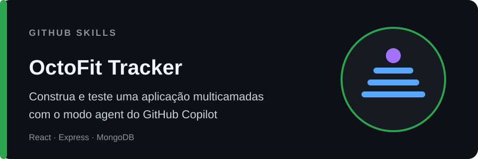

# Construa e teste uma aplicação multicamadas com o GitHub Copilot

_Use o modo agent do GitHub Copilot para implementar, testar e revisar uma aplicação React + Express + MongoDB com base em contratos executáveis._

## Boas-vindas

- **Para quem é**: pessoas desenvolvedoras familiarizadas com GitHub, VS Code, JavaScript/TypeScript e fluxos básicos do GitHub Copilot.
- **O que você vai aprender**: usar o modo agent do Copilot como parceiro de engenharia, respeitando limites de arquitetura, trabalhando a partir de testes, validando código gerado e revisando mudanças multicamadas.
- **O que você vai construir**: o OctoFit Tracker, com registro de atividades, gerenciamento de equipes, placar competitivo e sugestões personalizadas de treino.
- **Pré-requisitos**:
  - [Começando com o GitHub Copilot](https://github.com/skills/getting-started-with-github-copilot)
  - Familiaridade com React, APIs HTTP e testes automatizados.
  - Acesso ao [GitHub Codespaces](https://github.com/features/codespaces).
- **Duração**: de 90 a 120 minutos, dependendo da sua familiaridade com o GitHub Copilot.

Neste exercício, você vai:

1. Explicar e preservar os limites entre as camadas de apresentação, lógica e dados.
1. Usar testes com falha e contratos explícitos para delimitar o trabalho do Copilot.
1. Implementar e testar modelos de dados Mongoose e dados representativos de demonstração.
1. Implementar e testar o comportamento da API Express, incluindo validações e estados de erro.
1. Implementar e testar rotas React e experiências orientadas pela API.
1. Verificar o sistema integrado e revisar uma pull request multicamadas antes de mesclá-la.

### Como iniciar este exercício

Copie o exercício para sua conta, aguarde cerca de **20 segundos** para que a Mona prepare a primeira lição e atualize a página.

Está com dificuldades? 🤷
 

Ao copiar o exercício, recomendamos estas configurações:

- Para proprietário, escolha sua conta pessoal ou uma organização que hospedará o repositório.
- Recomendamos criar um repositório público, pois repositórios privados consomem minutos do Actions.
- Se o exercício não estiver pronto em 20 segundos, abra a aba **Actions** no repositório copiado.
- Se um job falhar, execute-o novamente uma vez. Se falhar de novo, abra uma issue com o link do log do workflow.

---

&copy; 2025 GitHub &bull; [Código de Conduta](https://www.contributor-covenant.org/version/2/1/code_of_conduct/code_of_conduct.md) &bull; [Licença MIT](https://gh.io/mit)
